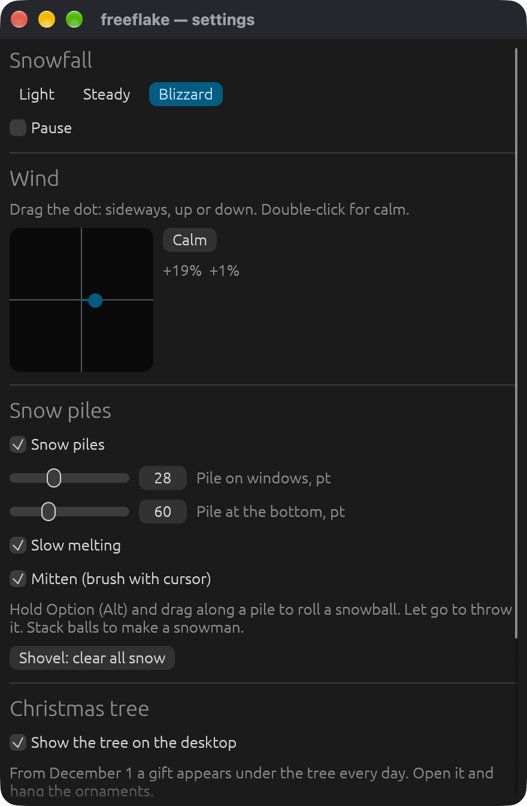
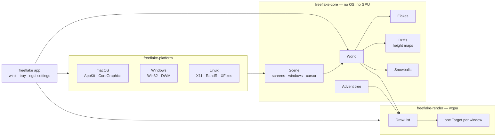

<p align="center">
  
</p>

<h1 align="center">freeflake</h1>

<p align="center">
  <b>Let it snow on your desktop — for free.</b><br>
  Snow that piles up on your windows, snowmen you roll with the cursor, and an advent Christmas tree with a gift for every day of December.
</p>

<p align="center">
  <a href="https://github.com/kewldan/freeflake/releases/latest"><b>⬇️ Download the latest release</b></a>
  &nbsp;·&nbsp;
  <a href="#-install">Install guide</a>
</p>

<p align="center">
  <a href="https://github.com/kewldan/freeflake/releases/latest"></a>
  <a href="https://github.com/kewldan/freeflake/releases"></a>
  <a href="https://github.com/kewldan/freeflake/actions/workflows/ci.yml"></a>
  <br>
  
  
  
  
  <br>
  
  
  
  
  
  <a href="LICENSE"></a>
</p>

<p align="center">
  
</p>

## ✨ Highlights

- ❄️ **Three kinds of weather.** Light, steady or a blizzard, with wind in any direction — sideways, updrafts, downdrafts — and gusts.
- 🏔️ **Snow piles up.** On window tops, on the Dock or taskbar and at the bottom of the screen. Windows in front hide the snow behind them, just like real windows would.
- 🫨 **Shake it off.** Drag a window fast and the snow flies off. Close it and the snow falls down.
- 🧤 **Mitten and shovel.** Brush snow away with the cursor, or clear everything at once from the menu.
- ⛄ **Snowballs and snowmen.** Hold <kbd>Option</kbd> (<kbd>Alt</kbd>) and drag along a pile to roll a snowball that grows as it picks up snow. Let go to throw it. Stack balls and they become a snowman — three balls get a top hat.
- 🎄 **Advent Christmas tree.** A tree stands on your desktop. From December 1 a gift appears under it every day: balls, bells, stars, icicles, candy canes, garlands of blinking lights and, on Christmas Eve, the star for the top. Drag the ornaments onto the branches. Snow settles on the tree too.
- 🖱️ **Never in the way.** Clicks pass through the snow; it only catches the mouse while you hold <kbd>Option</kbd> over a pile.
- 🖥️ **Every monitor, every desktop.** Snow on all screens and all Spaces / virtual desktops.
- 🔋 **Light on the battery.** GPU-rendered, the window list is read on a background thread, and the snow gets lighter on battery saver or when the machine is hot.
- 🔒 **Private.** freeflake looks only at window positions, never their contents. No network, no account, no permissions to grant.

> [!TIP]
> Open **Settings…** from the snowflake in the menu bar (or tray) for the wind pad, pile sizes, frame rate and **Start at login**.

## 📥 Install

### macOS

> [!NOTE]
> Requires **macOS 14 Sonoma or later**. Native builds for Apple Silicon and Intel.

**With Homebrew** (recommended — no Gatekeeper prompts):

```sh
brew install kewldan/tap/freeflake
freeflake &
```

To start it at login, tick **Start at login** in Settings, or run `brew services start freeflake`.

**Or download the app:**

1. Download `freeflake-<version>-aarch64-apple-darwin.app.zip` (Apple Silicon) or `…-x86_64-apple-darwin.app.zip` (Intel) from the [latest release](https://github.com/kewldan/freeflake/releases/latest).
2. Unzip it and move **freeflake** to **Applications**.
3. **Open it the first time.** The build is not signed by Apple, so macOS blocks the first launch:
   1. Double-click **freeflake**. macOS says it can't verify the app — click **Done**.
   2. Open **System Settings → Privacy & Security**, scroll to *"freeflake" was blocked…* and click **Open Anyway**.

   <details>
   <summary>Prefer Terminal?</summary>

   ```sh
   xattr -dr com.apple.quarantine /Applications/freeflake.app
   ```

   </details>

A snowflake appears in the menu bar. There is no Dock icon.

### Windows

> [!NOTE]
> Requires **Windows 10 22H2 or Windows 11**.

Download `freeflake-<version>-x86_64-pc-windows-msvc.zip` from the [latest release](https://github.com/kewldan/freeflake/releases/latest), unzip it anywhere and run `freeflake.exe`. SmartScreen may warn about an unknown publisher: **More info → Run anyway**. The snowflake lives in the tray.

### Linux

> [!NOTE]
> Needs an **X11** session with a compositor, or **Wayland through XWayland**. On Wayland, snow piles up on X11 windows, panels and the bottom of the screen; native Wayland windows are not visible to freeflake. The tray icon uses StatusNotifierItem (KDE, most panels; GNOME needs the AppIndicator extension).

```sh
brew install kewldan/tap/freeflake   # or download the .tar.gz for x86_64 / aarch64
freeflake &
```

### Checksums

Every release has a `SHA256SUMS` file:

```sh
shasum -a 256 -c SHA256SUMS --ignore-missing
```

<details>
<summary>🧽 Uninstall</summary>

Quit freeflake from its menu, turn off **Start at login**, remove the app (or `brew uninstall freeflake`), then its settings:

```sh
rm -rf ~/Library/Application\ Support/freeflake   # macOS
rm -rf ~/.config/freeflake                        # Linux
rmdir /s %APPDATA%\freeflake                      # Windows
```

</details>

## 📸 Screenshots

| Desktop | Advent tree |
| :---: | :---: |
|  |  |
| **Settings** | |
|  | |

## 🎄 The advent calendar

| When | What happens |
| --- | --- |
| Before December | The bare tree waits on the desktop (hide it in Settings) |
| December 1–31 | One gift per day appears under the tree. Missed days stay openable |
| December 24 | The star for the top of the tree |
| January 1–14 | Every gift is available |
| Next December | A fresh tree |

Hung ornaments stay where you put them. Drag one off the tree to put it back on the floor; drop a garland at any height and it drapes across the branches.

## ⚡️ Performance

Measured on an M4 Pro, one 3024×1964 display, steady snowfall.

| | Result |
| --- | --- |
| Simulation step (~800 flakes, piles, snowballs) | **0.01–0.09 ms** |
| Main-thread work per frame | **~0.75 ms** |
| CPU at 60 fps / 30 fps | **~13% / ~8%** of one core |
| Memory | **~85 MB** (mostly the GPU driver) |

The frame rate is **60 fps** by default and adjustable in Settings (20–120), with a separate rate for battery saver (30 by default).

How it stays light:

- Flakes are instanced discs and piles are one triangle mesh, drawn in a single render pass per screen with wgpu (Metal, DirectX 12, Vulkan).
- Snow piles are height maps of 3-point columns attached to windows; occlusion by windows in front is computed with interval subtraction, not per pixel.
- The window list is polled on a background thread: 60 Hz while something moves, 15 Hz when nothing does.
- The tree redraws at 20 fps unless you are interacting with it.

## 🛠️ Build from source

### Requirements

- Rust 1.88 or later (`rustup`)
- Linux: a C toolchain is enough; everything else is pure Rust

### Build and run

```sh
git clone https://github.com/kewldan/freeflake.git && cd freeflake
cargo run --release                  # the app
cargo run --release -- --settings    # open the settings window on start
```

Useful while developing:

```sh
cargo test --workspace
cargo clippy --workspace --all-targets -- -D warnings
FREEFLAKE_DATE=2026-12-24 cargo run --release            # pretend it is Christmas Eve
FREEFLAKE_PROFILE=1 RUST_LOG=info cargo run --release    # per-phase frame timings
FREEFLAKE_LANG=ru cargo run --release                    # force the Russian UI
cargo run --release -p freeflake-render --example snapshot -- out.png   # render a fake desktop offscreen
cargo run --release -p freeflake-render --example tree -- tree.png 24   # the tree on December 24
python3 design/make_icon.py                              # re-render the icon
```

Releases are built by GitHub Actions when a `v*` tag is pushed.

## 🏗️ Architecture



- **`freeflake-core`** — the simulation: flakes, piles, snowballs, snowmen and the advent tree. Pure Rust, covered by unit tests.
- **`freeflake-render`** — turns the world into instanced discs and triangles and draws them with wgpu; can render offscreen for snapshots.
- **`freeflake-platform`** — the `Desktop` trait: screens, the window stack, cursor, power state, and turning a window into a click-through overlay.
- **`freeflake`** — the app: per-screen overlay windows, the tree window, frame pacing, the tray menu, the egui settings window and persistence.

<details>
<summary>🗂️ Project layout</summary>

```
crates/
  core/src/        geom, settings, scene, flake, drift, snowball, advent, world
  render/src/      shader.wgsl, draw_list (snow), tree (advent tree), lib (wgpu)
  render/examples/ snapshot (fake desktop → PNG/frames), tree (tree → PNG)
  platform/src/    macos, windows, linux
  app/src/         app (event loop), tree_window, settings_window, tray,
                   config, autostart, i18n
design/            make_icon.py
docs/              ARCHITECTURE.md, screenshots, icon, snow.gif
packaging/         macOS Info.plist and icon, Homebrew formula template
.github/workflows/ ci.yml, release.yml
```

</details>

See [docs/ARCHITECTURE.md](docs/ARCHITECTURE.md) for the per-frame data flow.

## 🌍 Localization

freeflake speaks **English** and **Russian**, picked from the system locale. Strings live in `crates/app/src/i18n.rs`; set `FREEFLAKE_LANG=ru` or `en` to override.

## 🗺️ Known limitations

- 🐧 On Wayland, native Wayland windows are invisible to freeflake: snow falls over them but piles up only on X11 windows, panels and the screen bottom.
- 🪟 Windows and Linux builds are new; please [report](https://github.com/kewldan/freeflake/issues) anything odd.
- 🔏 Builds are not signed, so macOS and Windows ask for confirmation on first launch.
- 🖥️ With mixed DPI on Windows, monitors other than the primary use the primary's scale.

## 📄 License

freeflake is released under the [MIT License](LICENSE).
